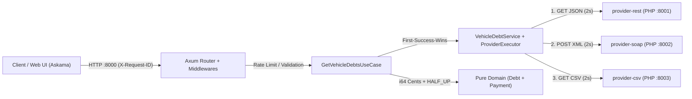

# Infocar

> **English** | [Português (BR)](README.pt-BR.md)

> A **Rust** (`axum` + `tokio`) reimplementation of the **Cardok** vehicle debt lookup & payment simulation monolith, keeping the satellite services in **PHP** for controlled benchmarking of latency, memory footprint, resilience, and strict contract parity.

---

## Overview & Architectural Thesis

**Infocar** was built as a controlled engineering benchmark: replacing the core monolith (originally PHP/Laravel) with a multi-stage compiled **Rust** binary while preserving **100% of public contracts** (JSON payloads, HTTP status codes, security headers, structured logs, and cent-exact financial rules) against the same PHP satellite providers over an isolated Docker network.



---

## Engineering Decisions & Invariants

1. **Strict Hexagonal Architecture (`monolith/src/domain/`)**
   - The domain layer is completely decoupled from HTTP frameworks (`axum`), network clients (`reqwest`), and serialization formats (`serde_json`, `roxmltree`, `csv`).
   - External adapters implement the async `VehicleDebtProvider` port and normalize JSON, XML, and defensive CSV into the canonical model (`ProviderDebtResponse` / `Vec<Debt>`) before crossing the domain boundary.

2. **Float-Free Financial Precision (`Money(i64)` + `HalfUpRounder`)**
   - All monetary amounts are stored and summed strictly as 64-bit integer cents (`i64`).
   - Rational rounding uses `HalfUpRounder::round(numerator, denominator)` with zero intermediate `f64` conversion.
   - The `20%` interest cap for `IPVA` and `LICENCIAMENTO` (`0.33%/day`) is applied to the exact numerator before division. `MULTA` applies `1.00%/day` uncapped.
   - `f64` is restricted exclusively to the dimensionless Price Table coefficient ($i = 0.025$/month for `6x` and `12x`), rounded once to integer cents.

3. ***First-Success-Wins* & *Fail-Fast* Resilience**
   - Configurable order via `PROVIDER_ORDER` (default `rest,soap,csv`) or explicit `"provider"` request override.
   - **Transient failures** (`ProviderError::Unavailable`: timeout, network error, HTTP 5xx): sequential retry with linear backoff (`attempt * PROVIDER_BACKOFF_MS`, default `100ms` and `200ms` for `PROVIDER_RETRIES=2`).
   - **Contract failures** (`ProviderError::InvalidResponse`: malformed JSON/XML/CSV): immediate *fail-fast* on the first attempt, triggering fallback to the next provider.
   - A valid response with `0` debts completes successfully (**does not** trigger fallback).

4. **Temporal Determinism (`Clock` trait)**
   - Overdue day calculations depend on an injectable `Clock` trait (defaulting to `FixedClock` at `2024-05-10T00:00:00Z`), preventing direct `Utc::now()` calls inside domain logic.

5. **Observability, Privacy (LGPD) & Caching**
   - `X-Request-ID` validation and propagation (`^[a-zA-Z0-9\-_]{1,64}$` or UUID v4 generation).
   - Mandatory license plate masking in all logs via `PlateMasker` (`ABC1234` → `ABC****`).
   - Single-line structured JSON logs emitted simultaneously to `stdout` and `monolith/storage/logs/laravel.log` (maintaining direct compatibility with audit and demo scripts).
   - `GET /api/health/integrations` uses a `5s` in-memory `RwLock` cache exposing `X-Cache: HIT|MISS` and honoring `Cache-Control: no-cache`.

---

## Benchmark Comparison: Cardok (PHP) vs Infocar (Rust)

Measured on the same Docker host, with both monoliths querying the exact same PHP satellite providers (`provider-rest`, `provider-soap`, `provider-csv`, `payment-provider`).

### Functional Parity (`diff -u`)
- **`ABC1234` and `LIC2024`**: **ZERO DIFF** between `cardok` (PHP) and `infocar` (Rust) JSON responses.

### Image & Memory Footprint

| Metric | Cardok (PHP 8.4 / Laravel) | Infocar (Rust 1.88 / Axum) | Difference |
| :--- | :---: | :---: | :---: |
| **Docker Image (`monolith`)** | `176MB` | `148MB` | `-15.9%` |
| **Idle Memory (`docker stats`)** | `73.08 MiB` | `2.47 MiB` | **~29.6x lower** |
| **Post-Load Memory (`docker stats`)** | `75.15 MiB` | `3.54 MiB` | **~21.2x lower** |

### Throughput & Latency Under Concurrency

| Scenario | Cardok (PHP) | Infocar (Rust) | Gain (Rust/PHP) |
| :--- | :---: | :---: | :---: |
| **`GET /api/health`** (500 reqs, conc. 20) | `49.58 req/s` · p50 `356.16 ms` · p99 `675.67 ms` | **`1108.04 req/s`** · p50 **`15.72 ms`** · p99 **`36.67 ms`** | **22.3x** throughput |
| **`GET /api/health/integrations`** (`X-Cache: HIT`, 300 reqs, conc. 15) | `27.58 req/s` · p50 `340.92 ms` · p99 `3088.94 ms` | **`1295.67 req/s`** · p50 **`10.51 ms`** · p99 **`21.25 ms`** | **47.0x** throughput |
| **`POST /api/v1/vehicles/debts`** (`ABC1234`, 50 reqs, conc. 5, via PHP `provider-rest`) | `9.00 req/s` · p50 `532.08 ms` · p99 `1031.76 ms` | **`36.01 req/s`** · p50 **`102.49 ms`** · p99 **`437.40 ms`** | **4.0x** throughput |

> In **Cardok (PHP)**, per-request framework bootstrapping and limited worker concurrency queue concurrent requests (`p99` up to `3088.94 ms` on the cached endpoint). In **Infocar (Rust)**, the async `tokio` runtime with resident `Arc<AppState>` keeps `p99` at `21.25 ms` on the in-memory cache and delivers **4x higher throughput** even when the external PHP `provider-rest` service becomes the bottleneck.

Full report available at [`specs/007-testes-e-comparacao/benchmark-report.md`](specs/007-testes-e-comparacao/benchmark-report.md).

---

## Quickstart & Operations

Prerequisite: **Docker** with Compose v2 (local Rust/Cargo is optional; the `Makefile` automatically falls back to the `rust:1.88-slim-bookworm` container).

```bash
# Start the full stack (multi-stage Rust build + 4 PHP containers) and wait for healthchecks
make up

# Validate Docker Compose, full test suite (49/49), and inter-container connectivity
make check

# Run end-to-end scenarios: success (LIC2024), REST->SOAP fallback (ABC1234), and 400 validation
make demo

# Run unit and integration test suites only
make test

# Run CLI connectivity diagnostics against PHP services
make health

# Tail structured JSON logs in real time
make logs

# Stop all containers
make down
```

---

## HTTP Contracts (`:8000`)

| Method | Route | Description |
| :--- | :--- | :--- |
| `GET` | `/` | Web UI (`askama` + Tailwind CSS) for license plate lookup |
| `POST` | `/api/v1/vehicles/debts` | Debt lookup, interest calculation, and payment simulation (`200`, `400`, `422`, `429`, `503`) |
| `GET` | `/api/health` | Fast monolith health check |
| `GET` | `/api/health/integrations` | PHP provider health with `5s` cache (`X-Cache: HIT\|MISS`) |
| `GET` | `/api/metrics` | Real-time lock-free atomic counters (`AtomicU64`) |

Sample request:

```bash
curl -s -X POST http://localhost:8000/api/v1/vehicles/debts \
  -H "Content-Type: application/json" \
  -d '{"placa":"ABC1234"}' | jq .
```

---

## Repository Layout & Spec-Driven Phases

```text
infocar/
├── monolith/                        # Rust Monolith (Cargo + Axum + Askama)
│   ├── src/domain/                  # Pure financial core (Money, Rounding, Policies, Payment)
│   ├── src/application/             # Orchestration, Retry, Fallback, and PlateMasker
│   ├── src/infrastructure/          # REST/SOAP/CSV adapters, Metrics, and StructuredLogger
│   ├── src/http/                    # Axum Router, Handlers, Cache, and Middlewares
│   ├── src/cli/                     # check-services CLI subcommand
│   ├── templates/                   # Tailwind HTML template (lookup.html)
│   └── tests/                       # HTTP, Resilience, and Web UI integration tests
├── provider-rest/                   # PHP satellite service (JSON) — :8001
├── provider-soap/                   # PHP satellite service (XML)  — :8002
├── provider-csv/                    # PHP satellite service (CSV)  — :8003
├── payment-provider/                # PHP satellite service (internal network)
├── specs/                           # Phase-by-phase specs, plans, and tasks (001..007)
├── docs/                            # Architectural blueprint and phase guides
├── docker-compose.yml
└── Makefile
```

### Reference Documentation
- **Project Constitution**: [`.specify/memory/constitution.md`](.specify/memory/constitution.md)
- **Architectural Blueprint**: [`docs/00-plano-arquitetural-rust.md`](docs/00-plano-arquitetural-rust.md)
- **API & Log Contracts**: [`specs/001-rust-monolith-core/contracts/api-contracts.md`](specs/001-rust-monolith-core/contracts/api-contracts.md)
- **Benchmark Report**: [`specs/007-testes-e-comparacao/benchmark-report.md`](specs/007-testes-e-comparacao/benchmark-report.md)
