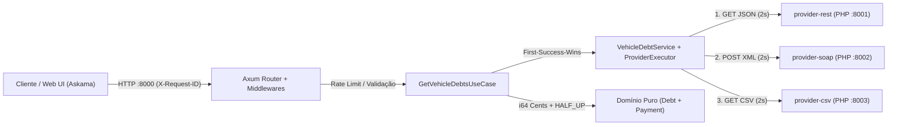

# Infocar

> Reimplementação em **Rust** (`axum` + `tokio`) do núcleo monolítico de consulta e negociação de débitos veiculares do **Cardok**, mantendo os serviços satélites em **PHP** para benchmark controlado de latência, footprint de memória, resiliência e paridade estrita de contratos.

---

## Visão Geral e Tese Arquitetural

O **Infocar** foi construído como um experimento comparativo de engenharia: substituir o monólito principal (originalmente PHP/Laravel) por um binário **Rust** compilado via multi-stage build, preservando **100% dos contratos públicos** (payloads JSON, códigos HTTP, headers de segurança, logs estruturados e regras financeiras ao centavo) e consumindo os mesmos provedores externos em PHP em rede Docker isolada.



---

## Decisões de Engenharia e Invariantes

1. **Arquitetura Hexagonal Estrita (`monolith/src/domain/`)**
   - A camada de domínio é agnóstica a frameworks HTTP (`axum`), clientes de rede (`reqwest`) e formatos de serialização (`serde_json`, `roxmltree`, `csv`).
   - Adaptadores externos implementam a porta assíncrona `VehicleDebtProvider` e normalizam JSON, XML e CSV defensivo para o modelo canônico (`ProviderDebtResponse` / `Vec<Debt>`) antes de cruzar a fronteira do domínio.

2. **Precisão Financeira sem Ponto Flutuante (`Money(i64)` + `HalfUpRounder`)**
   - Todos os valores monetários são armazenados e somados exclusivamente em centavos inteiros (`i64`).
   - O arredondamento racional utiliza `HalfUpRounder::round(numerator, denominator)` sem conversão intermediária para `f64`.
   - O teto de `20%` para `IPVA` e `LICENCIAMENTO` (`0,33%/dia`) é aplicado sobre o numerador exato antes da divisão. `MULTA` aplica `1,00%/dia` sem teto.
   - `f64` é restrito exclusivamente ao coeficiente adimensional da Tabela Price ($i = 0.025$ a.m. em `6x` e `12x`), arredondado uma única vez para centavos inteiros.

3. **Resiliência *First-Success-Wins* e *Fail-Fast***
   - Ordem configurável via `PROVIDER_ORDER` (padrão `rest,soap,csv`) ou override explícito `"provider"` no request.
   - **Falhas transitórias** (`ProviderError::Unavailable`: timeout, erro de rede, HTTP 5xx): retry sequencial com backoff linear (`attempt * PROVIDER_BACKOFF_MS`, padrão `100ms` e `200ms` para `PROVIDER_RETRIES=2`).
   - **Falhas de contrato** (`ProviderError::InvalidResponse`: JSON/XML/CSV malformado): *fail-fast* imediato na 1ª tentativa, acionando fallback para o próximo provedor.
   - Resposta válida com `0` débitos encerra a consulta com sucesso (**não** dispara fallback).

4. **Determinismo Temporal (`Clock` trait)**
   - Regras de atraso dependem da trait `Clock` injetável (padrão `FixedClock` em `2024-05-10T00:00:00Z`), evitando chamadas diretas a `Utc::now()` no domínio.

5. **Observabilidade, Privacidade (LGPD) e Cache**
   - Propagação e validação de `X-Request-ID` (`^[a-zA-Z0-9\-_]{1,64}$` ou geração de UUID v4).
   - Mascaramento obrigatório de placas em logs via `PlateMasker` (`ABC1234` → `ABC****`).
   - Logs estruturados em JSON de linha única emitidos simultaneamente em `stdout` e `monolith/storage/logs/laravel.log` (mantendo compatibilidade direta com os scripts de auditoria e demonstração).
   - `GET /api/health/integrations` utiliza cache em memória com TTL de `5s` (`RwLock`) expondo `X-Cache: HIT|MISS` e respeitando `Cache-Control: no-cache`.

---

## Footprint e Latência Observados

Medições coletadas na stack Docker local (`rust:1.88-slim-bookworm` → `debian:bookworm-slim` para o monólito; PHP 8.4 para os satélites):

| Serviço | Stack | Imagem | Memória (`docker stats`) |
| :--- | :--- | :--- | :--- |
| `infocar-monolith` | Rust (`axum` + `tokio`) | `148MB` | `2.055 MiB` |
| `infocar-provider-rest` | PHP 8.4 / Laravel | — | `59.93 MiB` |
| `infocar-provider-soap` | PHP 8.4 / Laravel | — | `60.52 MiB` |
| `infocar-provider-csv` | PHP 8.4 / Laravel | — | `59.04 MiB` |
| `infocar-payment-provider` | PHP 8.4 CLI | — | `10.75 MiB` |

- **`GET /api/health/integrations` (`X-Cache: HIT`)**: `~2.10 ms` (`time_total` via `curl`)
- **`POST /api/v1/vehicles/debts` (`ABC1234` ponta a ponta via PHP `provider-rest`)**: `~40.51 ms`

---

## Quickstart e Operação

Pré-requisito: **Docker** com Compose v2 (não é necessário ter Rust/Cargo instalado localmente; o `Makefile` usa o container `rust:1.88-slim-bookworm` automaticamente como fallback).

```bash
# Subir toda a stack (build multi-stage Rust + 4 containers PHP) e aguardar healthchecks
make up

# Validar Docker Compose, suíte completa de testes (49/49) e conectividade entre containers
make check

# Executar cenários ponta a ponta: sucesso (LIC2024), fallback REST->SOAP (ABC1234) e erro 400
make demo

# Executar apenas a suíte de testes unitários e de integração
make test

# Diagnóstico CLI de conectividade com os serviços PHP
make health

# Acompanhar logs JSON estruturados em tempo real
make logs

# Encerrar os containers
make down
```

---

## Contratos HTTP (`:8000`)

| Método | Rota | Descrição |
| :--- | :--- | :--- |
| `GET` | `/` | Interface Web (`askama` + Tailwind CSS) para consulta de placas |
| `POST` | `/api/v1/vehicles/debts` | Consulta débitos, calcula juros e simula pagamentos (`200`, `400`, `422`, `429`, `503`) |
| `GET` | `/api/health` | Health check rápido do monólito |
| `GET` | `/api/health/integrations` | Saúde dos provedores PHP com cache de 5s (`X-Cache: HIT\|MISS`) |
| `GET` | `/api/metrics` | Contadores atômicos lock-free (`AtomicU64`) em tempo real |

Exemplo de consulta:

```bash
curl -s -X POST http://localhost:8000/api/v1/vehicles/debts \
  -H "Content-Type: application/json" \
  -d '{"placa":"ABC1234"}' | jq .
```

---

## Estrutura do Repositório e Fases (Spec-Driven Development)

```text
infocar/
├── monolith/                        # Monólito em Rust (Cargo + Axum + Askama)
│   ├── src/domain/                  # Núcleo financeiro puro (Money, Rounding, Policies, Payment)
│   ├── src/application/             # Orquestração, Retry, Fallback e PlateMasker
│   ├── src/infrastructure/          # Adapters REST/SOAP/CSV, Metrics e StructuredLogger
│   ├── src/http/                    # Router Axum, Handlers, Cache e Middlewares
│   ├── src/cli/                     # Subcomando check-services
│   ├── templates/                   # Template HTML Tailwind (lookup.html)
│   └── tests/                       # Testes de integração HTTP, Resiliência e Web UI
├── provider-rest/                   # Serviço satélite PHP (JSON) — :8001
├── provider-soap/                   # Serviço satélite PHP (XML)  — :8002
├── provider-csv/                    # Serviço satélite PHP (CSV)  — :8003
├── payment-provider/                # Serviço satélite PHP (rede interna)
├── specs/                           # Especificações, planos e tarefas por fase (001..007)
├── docs/                            # Plano arquitetural e guias detalhados por fase
├── docker-compose.yml
└── Makefile
```

### Documentação de Referência
- **Constituição do Projeto**: [`.specify/memory/constitution.md`](.specify/memory/constitution.md)
- **Plano Arquitetural Geral**: [`docs/00-plano-arquitetural-rust.md`](docs/00-plano-arquitetural-rust.md)
- **Contratos de API e Logs**: [`specs/001-rust-monolith-core/contracts/api-contracts.md`](specs/001-rust-monolith-core/contracts/api-contracts.md)
- **Relatório de Medição**: [`specs/007-testes-e-comparacao/benchmark-report.md`](specs/007-testes-e-comparacao/benchmark-report.md)
