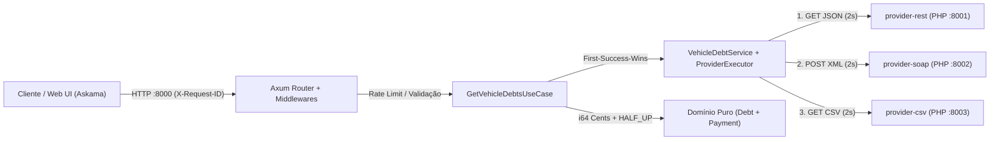

# Infocar

> [English](README.md) | **Português (BR)**

> Reimplementação em **Rust** (`axum` + `tokio`) do núcleo monolítico de consulta e negociação de débitos veiculares do **Cardok**, mantendo os serviços satélites em **PHP** para benchmark controlado de latência, footprint de memória, resiliência e paridade estrita de contratos.

---

## Visão Geral e Tese Arquitetural

O **Infocar** foi construído como um experimento comparativo de engenharia: substituir o monólito principal (originalmente PHP/Laravel) por um binário **Rust** compilado via multi-stage build, preservando **100% dos contratos públicos** (payloads JSON, códigos HTTP, headers de segurança, logs estruturados e regras financeiras ao centavo) e consumindo os mesmos provedores externos em PHP em rede Docker isolada.



---

## Decisões de Engenharia e Invariantes

1. **Arquitetura Hexagonal Estrita (`monolith/src/domain/`)**
   - A camada de domínio é agnóstica a frameworks HTTP (`axum`), clientes de rede (`reqwest`) e formatos de serialização (`serde_json`, `roxmltree`, `csv`).
   - Adaptadores externos implementam a porta assíncrona `VehicleDebtProvider` e normalizam JSON, XML e CSV defensivo para o modelo canônico (`ProviderDebtResponse` / `Vec<Debt>`) antes de cruzar a fronteira do domínio.

2. **Precisão Financeira sem Ponto Flutuante (`Money(i64)` + `HalfUpRounder`)**
   - Todos os valores monetários são armazenados e somados exclusivamente em centavos inteiros (`i64`).
   - O arredondamento racional utiliza `HalfUpRounder::round(numerator, denominator)` sem conversão intermediária para `f64`.
   - O teto de `20%` para `IPVA` e `LICENCIAMENTO` (`0,33%/dia`) é aplicado sobre o numerador exato antes da divisão. `MULTA` aplica `1,00%/dia` sem teto.
   - `f64` é restrito exclusivamente ao coeficiente adimensional da Tabela Price ($i = 0.025$ a.m. em `6x` e `12x`), arredondado uma única vez para centavos inteiros.

3. **Resiliência *First-Success-Wins* e *Fail-Fast***
   - Ordem configurável via `PROVIDER_ORDER` (padrão `rest,soap,csv`) ou override explícito `"provider"` no request.
   - **Falhas transitórias** (`ProviderError::Unavailable`: timeout, erro de rede, HTTP 5xx): retry sequencial com backoff linear (`attempt * PROVIDER_BACKOFF_MS`, padrão `100ms` e `200ms` para `PROVIDER_RETRIES=2`).
   - **Falhas de contrato** (`ProviderError::InvalidResponse`: JSON/XML/CSV malformado): *fail-fast* imediato na 1ª tentativa, acionando fallback para o próximo provedor.
   - Resposta válida com `0` débitos encerra a consulta com sucesso (**não** dispara fallback).

4. **Determinismo Temporal (`Clock` trait)**
   - Regras de atraso dependem da trait `Clock` injetável (padrão `FixedClock` em `2024-05-10T00:00:00Z`), evitando chamadas diretas a `Utc::now()` no domínio.

5. **Observabilidade, Privacidade (LGPD) e Cache**
   - Propagação e validação de `X-Request-ID` (`^[a-zA-Z0-9\-_]{1,64}$` ou geração de UUID v4).
   - Mascaramento obrigatório de placas em logs via `PlateMasker` (`ABC1234` → `ABC****`).
   - Logs estruturados em JSON de linha única emitidos simultaneamente em `stdout` e `monolith/storage/logs/laravel.log` (mantendo compatibilidade direta com os scripts de auditoria e demonstração).
   - `GET /api/health/integrations` utiliza cache em memória com TTL de `5s` (`RwLock`) expondo `X-Cache: HIT|MISS` e respeitando `Cache-Control: no-cache`.

---

## Benchmark Comparativo: Cardok (PHP) vs Infocar (Rust)

Medições executadas no mesmo host Docker, com ambos os monólitos consumindo os mesmos provedores satélites em PHP (`provider-rest`, `provider-soap`, `provider-csv`, `payment-provider`).

### Paridade Funcional (`diff -u`)
- **`ABC1234` e `LIC2024`**: **ZERO DIFF** entre as respostas JSON do `cardok` (PHP) e `infocar` (Rust).

### Footprint de Imagem e Memória

| Métrica | Cardok (PHP 8.4 / Laravel) | Infocar (Rust 1.88 / Axum) | Diferença |
| :--- | :---: | :---: | :---: |
| **Imagem Docker (`monolith`)** | `176MB` | `148MB` | `-15.9%` |
| **Memória em Idle (`docker stats`)** | `73.08 MiB` | `2.47 MiB` | **~29,6x menor** |
| **Memória Pós-Carga (`docker stats`)** | `75.15 MiB` | `3.54 MiB` | **~21,2x menor** |

### Throughput e Latência sob Concorrência

| Cenário | Cardok (PHP) | Infocar (Rust) | Ganho (Rust/PHP) |
| :--- | :---: | :---: | :---: |
| **`GET /api/health`** (500 reqs, conc. 20) | `49.58 req/s` · p50 `356.16 ms` · p99 `675.67 ms` | **`1108.04 req/s`** · p50 **`15.72 ms`** · p99 **`36.67 ms`** | **22,3x** throughput |
| **`GET /api/health/integrations`** (`X-Cache: HIT`, 300 reqs, conc. 15) | `27.58 req/s` · p50 `340.92 ms` · p99 `3088.94 ms` | **`1295.67 req/s`** · p50 **`10.51 ms`** · p99 **`21.25 ms`** | **47,0x** throughput |
| **`POST /api/v1/vehicles/debts`** (`ABC1234`, 50 reqs, conc. 5, via PHP `provider-rest`) | `9.00 req/s` · p50 `532.08 ms` · p99 `1031.76 ms` | **`36.01 req/s`** · p50 **`102.49 ms`** · p99 **`437.40 ms`** | **4,0x** throughput |

> No **Cardok (PHP)**, o ciclo de bootstrap por requisição e a concorrência limitada enfileiram chamadas simultâneas (`p99` até `3088.94 ms` no endpoint cacheado). No **Infocar (Rust)**, o runtime assíncrono `tokio` com `Arc<AppState>` residente mantém o `p99` em `21.25 ms` no cache em memória e entrega **4x mais throughput** mesmo quando o gargalo externo passa a ser o `provider-rest` em PHP.

### Resumo Executivo (Onde o Rust Venceu)

Em todos os cenários medidos de execução, o **Rust** venceu com **100% de paridade funcional (`ZERO DIFF`)**:

| Dimensão | Vencedor | Margem |
| :--- | :---: | :--- |
| **Imagem Docker** | Rust (`148MB` vs `176MB`) | `-15.9%` |
| **Memória em Idle** | Rust (`2.47 MiB` vs `73.08 MiB`) | **~29,6x menor** |
| **Memória Pós-Carga** | Rust (`3.54 MiB` vs `75.15 MiB`) | **~21,2x menor** |
| **`GET /api/health`** | Rust (`1108.04` vs `49.58 req/s`) | **22,3x** throughput |
| **`GET /api/health/integrations` (cache)** | Rust (`1295.67` vs `27.58 req/s`) | **47,0x** throughput |
| **`POST /api/v1/vehicles/debts` (via PHP)** | Rust (`36.01` vs `9.00 req/s`) | **4,0x** throughput |
| **Paridade de Contrato (`diff -u`)** | Empate (`ZERO DIFF`) | 100% idênticos |

> **Nuances de engenharia:** (1) No `POST /api/v1/vehicles/debts`, o ganho cai de `47x` para `4x` porque o gargalo externo passa a ser o `provider-rest` em PHP (`~100ms`/chamada); (2) O PHP vence em **tempo de build** no ciclo de desenvolvimento, pois não possui etapa de compilação (`cargo build --release`).

Relatório completo em [`specs/007-testes-e-comparacao/benchmark-report.md`](specs/007-testes-e-comparacao/benchmark-report.md).

---

## Quickstart e Operação

Pré-requisito: **Docker** com Compose v2 (não é necessário ter Rust/Cargo instalado localmente; o `Makefile` usa o container `rust:1.88-slim-bookworm` automaticamente como fallback).

```bash
# Subir toda a stack (build multi-stage Rust + 4 containers PHP) e aguardar healthchecks
make up

# Validar Docker Compose, suíte completa de testes (49/49) e conectividade entre containers
make check

# Executar cenários ponta a ponta: sucesso (LIC2024), fallback REST->SOAP (ABC1234) e erro 400
make demo

# Executar apenas a suíte de testes unitários e de integração
make test

# Diagnóstico CLI de conectividade com os serviços PHP
make health

# Acompanhar logs JSON estruturados em tempo real
make logs

# Encerrar os containers
make down
```

---

## Contratos HTTP (`:8000`)

| Método | Rota | Descrição |
| :--- | :--- | :--- |
| `GET` | `/` | Interface Web (`askama` + Tailwind CSS) para consulta de placas |
| `POST` | `/api/v1/vehicles/debts` | Consulta débitos, calcula juros e simula pagamentos (`200`, `400`, `422`, `429`, `503`) |
| `GET` | `/api/health` | Health check rápido do monólito |
| `GET` | `/api/health/integrations` | Saúde dos provedores PHP com cache de 5s (`X-Cache: HIT\|MISS`) |
| `GET` | `/api/metrics` | Contadores atômicos lock-free (`AtomicU64`) em tempo real |

Exemplo de consulta:

```bash
curl -s -X POST http://localhost:8000/api/v1/vehicles/debts \
  -H "Content-Type: application/json" \
  -d '{"placa":"ABC1234"}' | jq .
```

---

## Estrutura do Repositório e Fases (Spec-Driven Development)

```text
infocar/
├── monolith/                        # Monólito em Rust (Cargo + Axum + Askama)
│   ├── src/domain/                  # Núcleo financeiro puro (Money, Rounding, Policies, Payment)
│   ├── src/application/             # Orquestração, Retry, Fallback e PlateMasker
│   ├── src/infrastructure/          # Adapters REST/SOAP/CSV, Metrics e StructuredLogger
│   ├── src/http/                    # Router Axum, Handlers, Cache e Middlewares
│   ├── src/cli/                     # Subcomando check-services
│   ├── templates/                   # Template HTML Tailwind (lookup.html)
│   └── tests/                       # Testes de integração HTTP, Resiliência e Web UI
├── provider-rest/                   # Serviço satélite PHP (JSON) — :8001
├── provider-soap/                   # Serviço satélite PHP (XML)  — :8002
├── provider-csv/                    # Serviço satélite PHP (CSV)  — :8003
├── payment-provider/                # Serviço satélite PHP (rede interna)
├── specs/                           # Especificações, planos e tarefas por fase (001..007)
├── docs/                            # Plano arquitetural e guias detalhados por fase
├── docker-compose.yml
└── Makefile
```

### Documentação de Referência
- **Constituição do Projeto**: [`.specify/memory/constitution.md`](.specify/memory/constitution.md)
- **Plano Arquitetural Geral**: [`docs/00-plano-arquitetural-rust.md`](docs/00-plano-arquitetural-rust.md)
- **Contratos de API e Logs**: [`specs/001-rust-monolith-core/contracts/api-contracts.md`](specs/001-rust-monolith-core/contracts/api-contracts.md)
- **Relatório de Medição**: [`specs/007-testes-e-comparacao/benchmark-report.md`](specs/007-testes-e-comparacao/benchmark-report.md)
